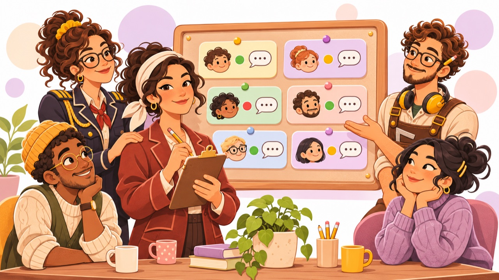
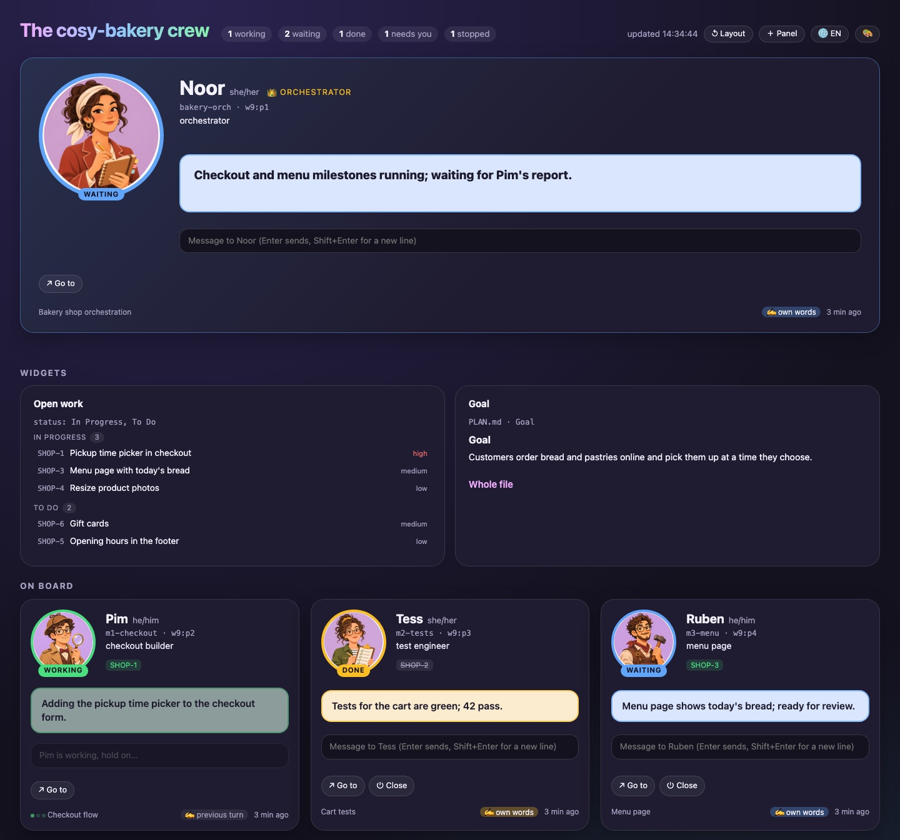

# herdr-crew



herdr-crew is a local web dashboard, two agent skills and two OpenCode commands for projects with several coding agents running side by side in [Herdr](https://herdr.dev), a terminal multiplexer for coding agents. One long lived orchestrator plans the work and starts short lived milestone agents, each in its own Herdr tab. Backlog.md tasks are their handover.

## 🧭 Why

- Several agents across several tabs make it hard to see who's working, who's waiting for you and who's done. The dashboard puts the whole crew on one page.
- Each agent has a persona with a name, pronouns, role and portrait, plus a one sentence update in its own words. That makes agents easier to tell apart and talk about.
- 💬 Messages between agents wait until the recipient is idle and its input box is empty, so they don't land in a draft you're typing.
- Agents keep their plans and notes in Backlog.md tasks, so closing a tab doesn't lose them. Everything runs locally from a git clone with no dependencies, build step or global install.

## 👀 What you see

The orchestrator has a card at the top with a short summary. Each agent has a card with its Herdr status (working, waiting, done or needs you), its own bubble, Backlog.md tasks, last incoming message and a context bar. Closed agents are greyed out with their last words. Panels can show open tasks, part of a plan, links or a dev server.

You can chat with an agent, jump to it in Herdr with Go to, close and reopen agents, onboard new ones, add a panel by describing it, and change the theme or language. English and Dutch ship with the dashboard; more languages can be added. Nothing happens without your click and a confirmation, and the server listens only on `127.0.0.1`.



## 📋 Requirements

- Node 22 or newer.
- Herdr, tested with 0.9.5.
- OpenCode is the best supported agent. Other agents get status and bubble cards, but no dashboard chat.
- Optional: Backlog.md 1.53.0 or later for task cards and live task updates.
- Optional: Anthropic or OpenAI credentials for the lead summary, generated themes and theme avatars.
- macOS is tested. Linux should work; Windows is not supported.

## 🔧 Install

```sh
git clone https://github.com/dirkluijk/herdr-crew.git
cd herdr-crew
node server.mjs install
node server.mjs doctor
```

`install` links the skills and commands into your OpenCode config directory as symlinks. It shows you the changes and asks first; it never overwrites your own files, and a `git pull` updates the links' targets. `doctor` checks Node, Herdr, OpenCode, Backlog.md and the links without changing anything, with a hint for each problem.

## 🚀 Quick start

Open your project in Herdr, start OpenCode in a pane and say "make a new Herdr crew" (or "maak een nieuwe Herdr crew"), or run `/crew`. The agent asks about the project, its own name and persona, languages, theme and port in one go. It starts the dashboard in a pane below it, opens it in your browser, then becomes the orchestrator and asks about your plan before starting another agent. Use `/orchestrate` to make an existing session the orchestrator.

## 🧹 Uninstall

```sh
node server.mjs uninstall
```

It asks first and removes only links pointing into this checkout. Each project keeps its `.herdr-crew.json` and `.herdr-crew/` folder; delete them by hand if you want.

## 📚 Learn more

- [DESIGN.md](DESIGN.md) covers architecture, requirements and install in detail, the new crew flow, commands and options, configuration, widgets and panels, languages, themes, safeguards, environment variables and limitations.
- Agent skills: [herdr-crew](skills/herdr-crew/SKILL.md) and [herdr-orchestrator](skills/herdr-orchestrator/SKILL.md).
- [Herdr](https://herdr.dev), [OpenCode](https://opencode.ai) and [Backlog.md](https://backlog.md).

License: MIT. See [LICENSE](LICENSE).
